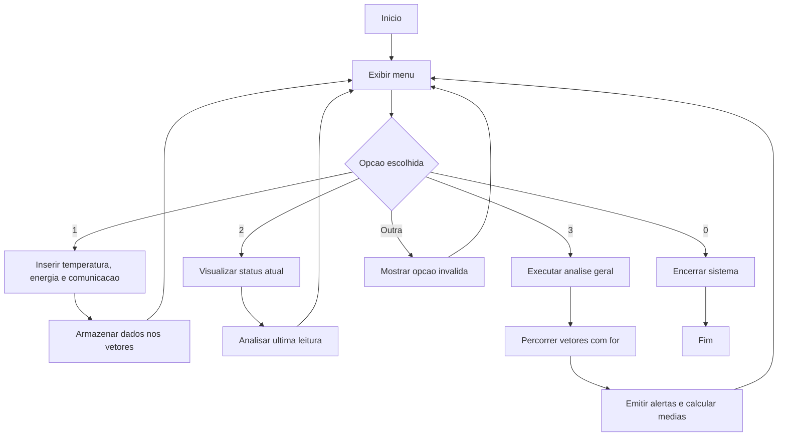

# Sistema de Monitoramento de Missao Espacial

## Explicacao da logica

O programa simula o monitoramento basico de uma missao espacial experimental.
Ele recebe dados informados pelo usuario, armazena essas informacoes em vetores
e depois executa analises usando estruturas condicionais.

Os dados monitorados sao:

- temperatura da nave;
- nivel de energia;
- status da comunicacao.

As regras de analise seguem o enunciado:

- se a temperatura for maior que 80, o sistema emite alerta de superaquecimento;
- se a energia for menor que 20, o sistema recomenda economia de energia;
- se a comunicacao for igual a 0, o sistema indica falha de comunicacao.

O menu principal usa `switch` para direcionar a opcao escolhida pelo usuario.
As repeticoes aparecem no `do while`, que mantem o sistema em funcionamento, e
nos lacos `for`, usados para percorrer o historico de leituras armazenado nos
vetores.

O codigo tambem usa funcoes simples para organizar melhor o programa:

- `exibirMenu`: mostra as opcoes do sistema;
- `inserirDados`: cadastra uma nova leitura;
- `visualizarStatus`: mostra a leitura mais recente;
- `executarAnalise`: percorre todas as leituras cadastradas;
- `calcularMediaTemperatura` e `calcularMediaEnergia`: calculam medias;
- `analisarLeitura`: verifica os alertas da missao.

## Fluxograma simples



## Exemplo de demonstracao pratica

Entrada sugerida para teste:

```text
1
90
15
0
2
3
0
```

Resultado esperado:

- alerta de superaquecimento;
- recomendacao de economia de energia;
- falha de comunicacao;
- resumo geral com uma leitura cadastrada.
